# AA2 - Servidor d'impressió CUPS

Prova de concepte: un servidor Ubuntu comparteix una impressora virtual (cups-pdf) amb un client Zorin OS.

## Índex

0. [Entorn de treball](#0-entorn-de-treball)
1. [Instal·lació de CUPS](#1-installació-de-cups)
2. [Instal·lació de la impressora virtual cups-pdf](#2-installació-de-la-impressora-virtual-cups-pdf)
3. [Configuració de CUPS](#3-configuració-de-cups)
4. [Compartició de la impressora amb la interfície web](#4-compartició-de-la-impressora-amb-la-interfície-web)
5. [Configuració del client Zorin OS](#5-configuració-del-client-zorin-os)
6. [Proves d'impressió](#6-proves-dimpressió)
7. [Comprovació dels documents generats](#7-comprovació-dels-documents-generats)
8. [Incidències](#8-incidències)

---

## 0. Entorn de treball

| Màquina | Sistema | Hostname | Usuari | IP Host-only |
|---|---|---|---|---|
| Servidor | Ubuntu Server | `nom-servidor` | `usuari` | `192.168.56.101` |
| Client | Zorin OS | `nom-client` | `usuari` | `192.168.56.104` |

| Element | Valor |
|---|---|
| Impressora virtual | `PDF` (cups-pdf) |
| Nom de la impressora al client | `PDF_nom_servidor` |
| Port de CUPS | `631` |
| Carpeta dels PDF | `/home/usuari/PDF` |

---

## 1. Instal·lació de CUPS

### 1.1 Actualitzar i instal·lar el paquet

```bash
sudo apt update
sudo apt install cups -y
```

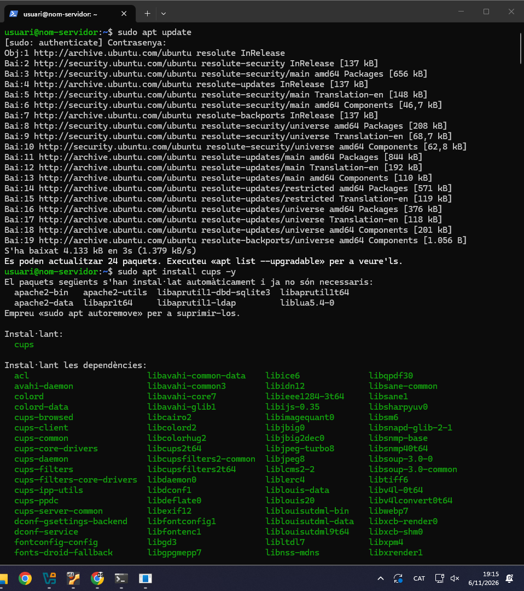

Primer actualitzo la llista de paquets. Després instal·lo CUPS i les seves dependències, com `cups-browsed` i `avahi-daemon`.

### 1.2 Activar i comprovar el servei

```bash
sudo systemctl enable --now cups
sudo systemctl status cups
```

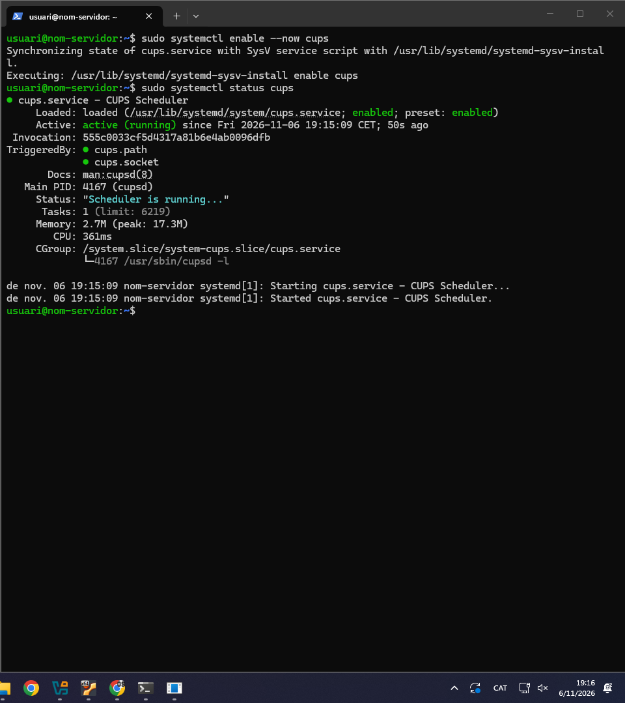

`enable --now` engega el servei i fa que s'iniciï amb el sistema. L'estat és **active (running)**, així que CUPS funciona.

---

## 2. Instal·lació de la impressora virtual cups-pdf

```bash
sudo apt install printer-driver-cups-pdf -y
lpstat -p
```

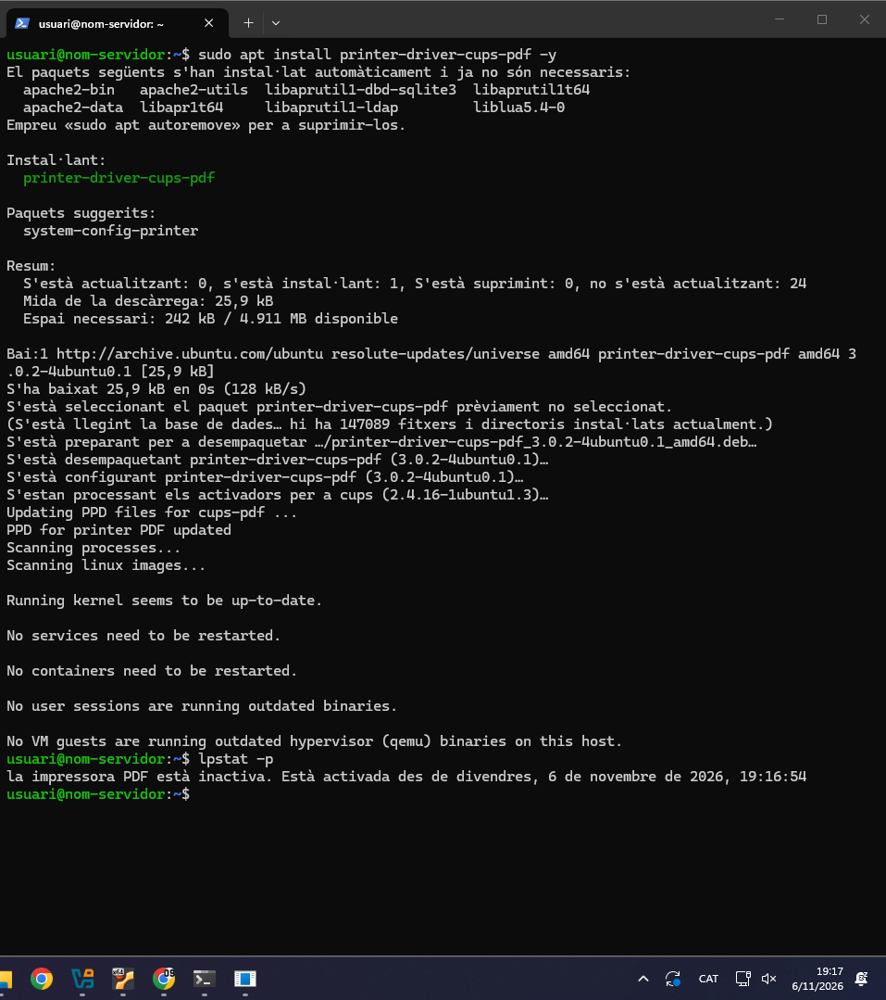

El paquet crea una impressora anomenada **PDF**. `lpstat -p` diu que està "inactiva". Això vol dir que està lliure, esperant treballs. No és cap error.

---

## 3. Configuració de CUPS

### 3.1 Còpia de seguretat

```bash
sudo cp /etc/cups/cupsd.conf /etc/cups/cupsd.conf.bak
```

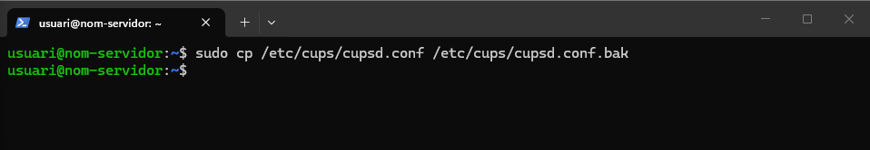

Abans de tocar res, faig una còpia del fitxer. Si alguna cosa va malament, puc tornar a l'original.

### 3.2 Fitxer original

```bash
sudo nano /etc/cups/cupsd.conf
```

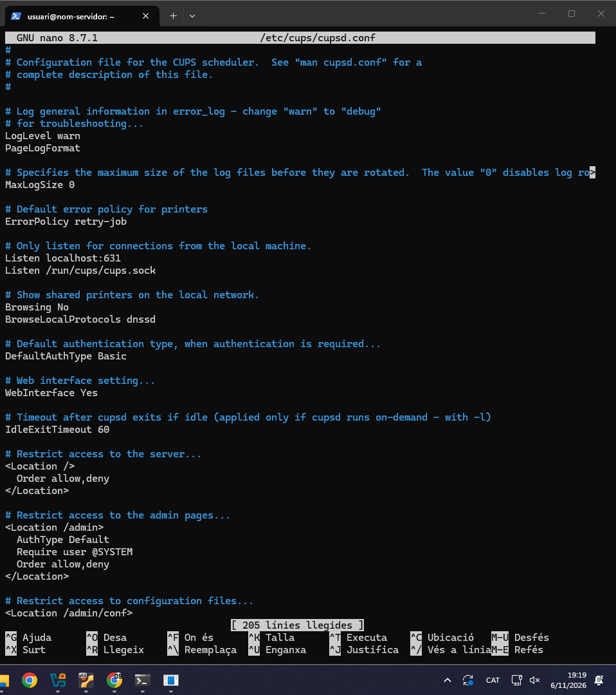

Al fitxer original es veu:

- `Listen localhost:631`: només escolta el mateix servidor.
- `Browsing No`: no anuncia les impressores.
- Les seccions `<Location>` no tenen cap `Allow`: ningú de fora pot entrar.

### 3.3 Canvi 1: `Browsing On`

```text
Browsing On
```


Ara el servidor **anuncia les impressores a la xarxa**. Així els clients les poden trobar sols.

### 3.4 Canvi 2: `Port 631`

```text
Port 631
```


Canvio `Listen localhost:631` per `Port 631`. Ara CUPS **escolta a totes les interfícies**, no només a localhost.

### 3.5 Canvi 3: `Allow @LOCAL` a `<Location />`

```text
<Location />
  Order allow,deny
  Allow @LOCAL
</Location>
```

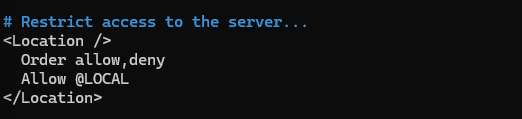

Aquesta línia **deixa accedir els equips de la xarxa local** al servidor i a les impressores.

### 3.6 Canvi 4: `Allow @LOCAL` a `<Location /admin>`

```text
<Location /admin>
  AuthType Default
  Require user @SYSTEM
  Order allow,deny
  Allow @LOCAL
</Location>
```

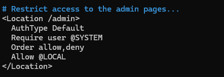

Aquesta línia **deixa administrar CUPS des de la xarxa local**. Continua sent segur: per `AuthType Default` i `Require user @SYSTEM`, CUPS demana usuari i contrasenya d'un administrador.

### 3.7 Resum dels canvis

| Directiva | Abans | Després | Per a què serveix |
|---|---|---|---|
| Escolta | `Listen localhost:631` | `Port 631` | Escoltar a totes les interfícies |
| Anunci | `Browsing No` | `Browsing On` | Anunciar les impressores a la xarxa |
| `<Location />` | sense `Allow` | `Allow @LOCAL` | Accés des de la xarxa local |
| `<Location /admin>` | sense `Allow` | `Allow @LOCAL` | Administració des de la xarxa local |

### 3.8 Comprovar els canvis amb `diff`

```bash
diff /etc/cups/cupsd.conf.bak /etc/cups/cupsd.conf
```

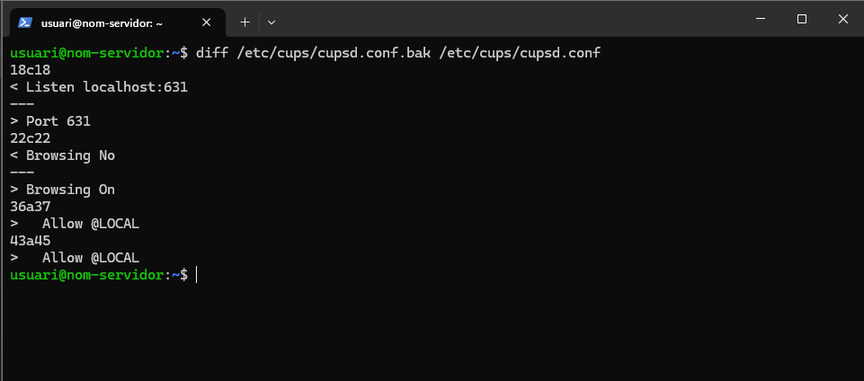

`diff` compara la còpia amb el fitxer nou. Surten exactament els 4 canvis i res més.

### 3.9 Reiniciar i comprovar el port

```bash
sudo systemctl restart cups
sudo systemctl status cups
sudo ss -tlnp | grep 631
```

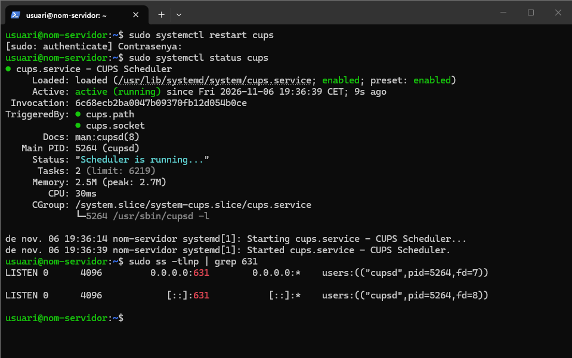

Reinicio CUPS per aplicar els canvis. El servei torna a estar **active (running)**. `ss` mostra `0.0.0.0:631`, que vol dir totes les interfícies IPv4. També surt `[::]:631` per a IPv6.

### 3.10 Afegir l'usuari al grup `lpadmin`

```bash
sudo usermod -aG lpadmin usuari
groups usuari
```

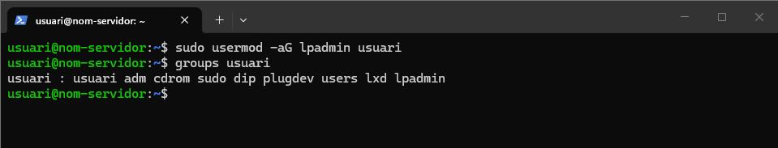

El grup `lpadmin` pot administrar CUPS. Ara l'usuari `usuari` pot entrar a l'administració de la web amb el seu usuari i contrasenya.

---

## 4. Compartició de la impressora amb la interfície web

### 4.1 Accés des del client

Al navegador del client obro:

```text
http://192.168.56.101:631
```

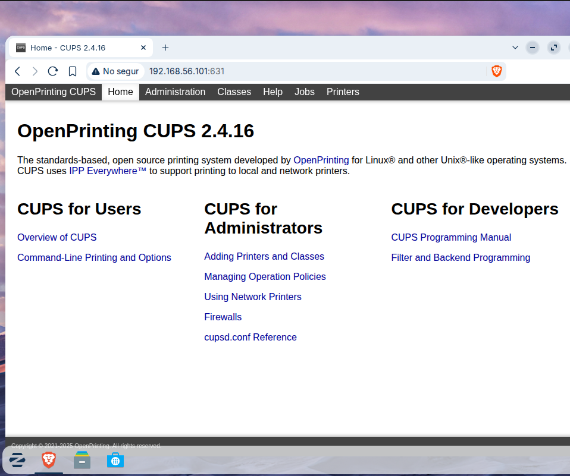

La pàgina de CUPS carrega des del client. Això demostra que el servidor escolta a la xarxa.

### 4.2 Pàgina d'Administració

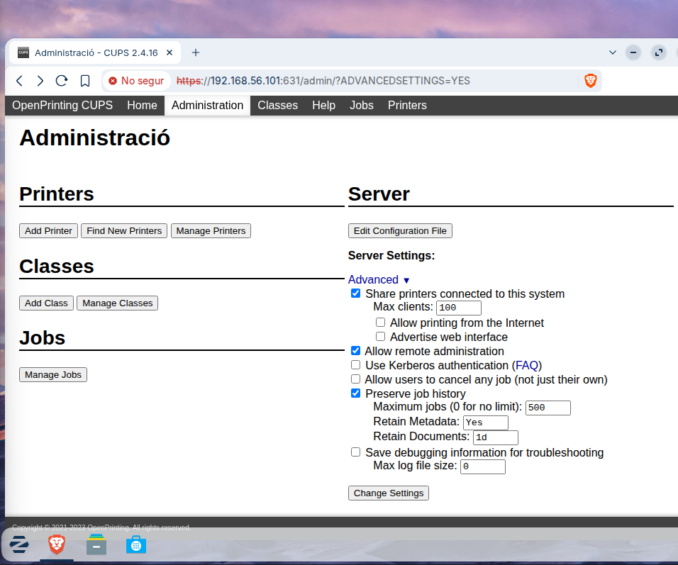

En entrar a **Administration**, el navegador avisa que el certificat és autosignat ("No segur"). És normal en una xarxa local. CUPS crea aquest certificat sol.

Les opcions **Share printers connected to this system** i **Allow remote administration** ja surten marcades. És gràcies als canvis que vaig fer al `cupsd.conf`.

### 4.3 Compartir la impressora PDF

**Printers → PDF → Administration → Modify Printer**

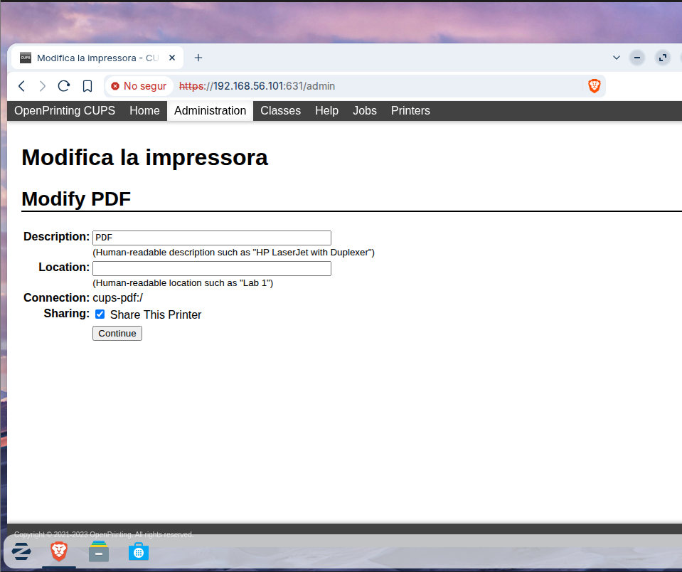

A la pantalla *Modify PDF* marco **Share This Printer** i continuo fins al final.

### 4.4 Comprovar que està compartida

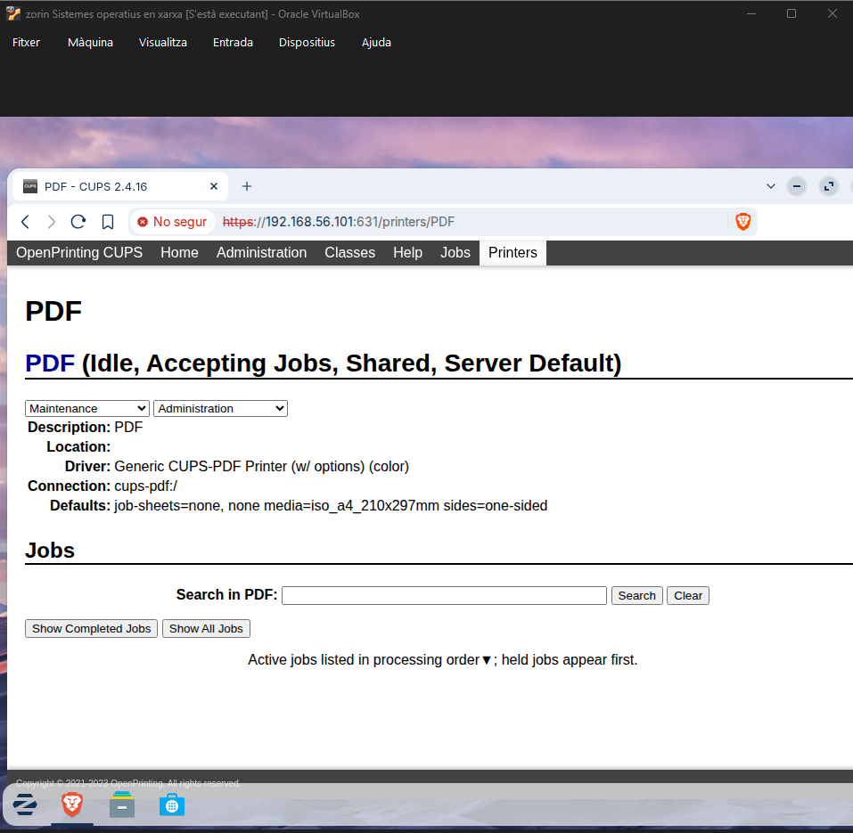

La impressora mostra **Idle, Accepting Jobs, Shared, Server Default**. Està lliure, accepta treballs i està compartida.

---

## 5. Configuració del client Zorin OS

### 5.1 La impressora apareix sola

**Paràmetres → Impressores**

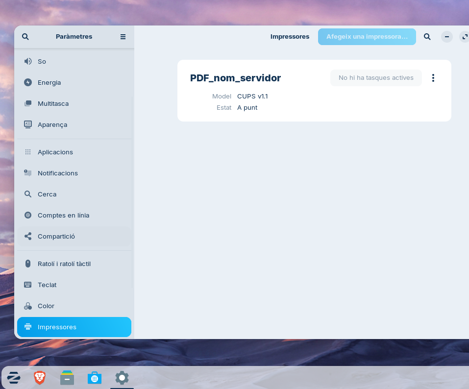

La impressora `PDF_nom_servidor` ja surt a la llista, amb estat **A punt**. No la vaig haver d'afegir. Apareix sola gràcies a `Browsing On` al servidor i al servei `cups-browsed` del client.

Quan vaig intentar afegir-la a mà, Zorin va dir **"No s'ha pogut afegir una impressora nova"**. El motiu és que ja existia.

### 5.2 Comprovar-ho amb `lpstat -v`

```bash
lpstat -v
```

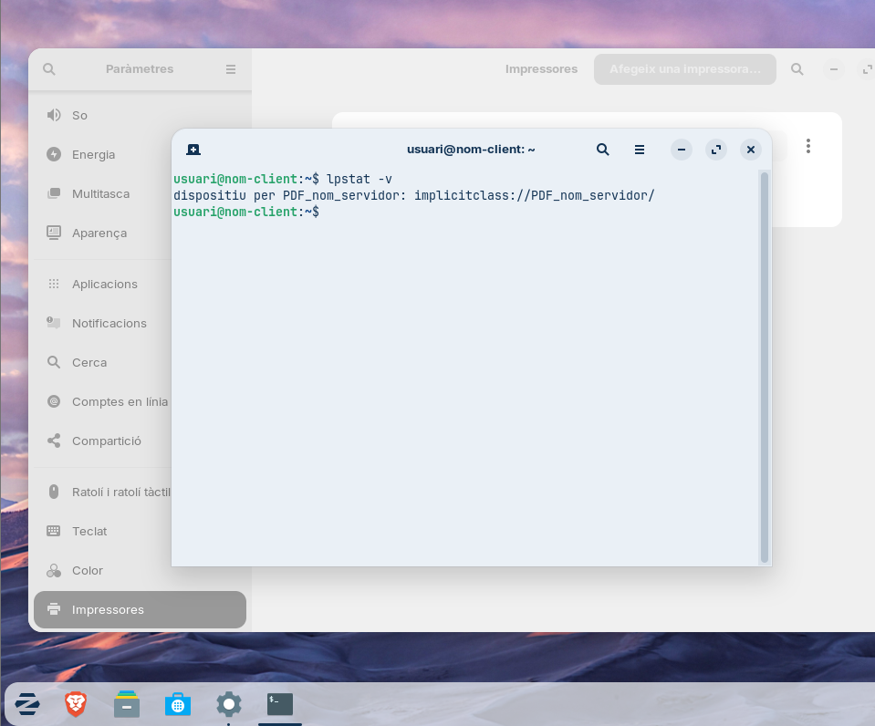

El dispositiu és `implicitclass://PDF_nom_servidor/`. `implicitclass` vol dir que la impressora l'ha creat `cups-browsed` de manera automàtica.

---

## 6. Proves d'impressió

### 6.1 Prova 1: pàgina de prova

**Paràmetres → Impressores → PDF_nom_servidor → Imprimeix una pàgina de prova**

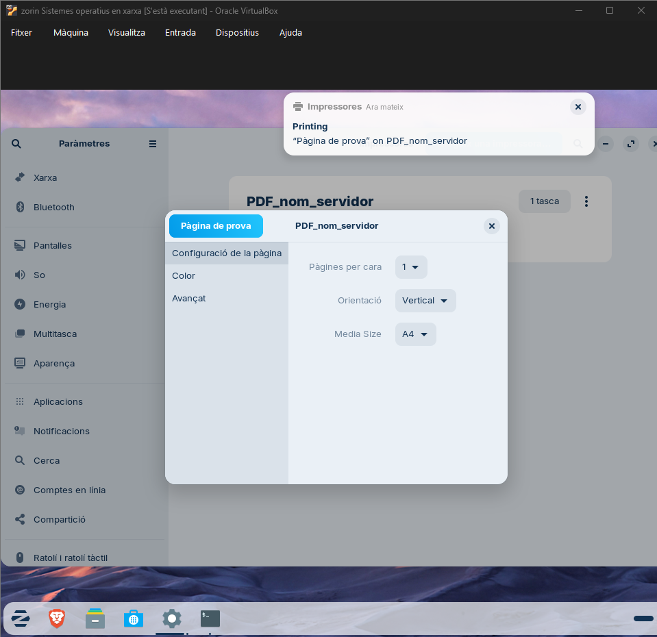

Surt la notificació **"Printing"** i la impressora marca **1 tasca**. El treball s'ha enviat al servidor.

### 6.2 Prova 2: fitxer de text des del terminal

```bash
echo "Prova d'impressió des del client Zorin" > prova.txt
lp -d PDF_nom_servidor prova.txt
```

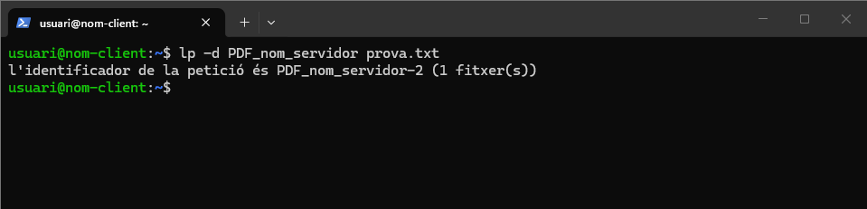

`lp -d` envia el fitxer a una impressora concreta. CUPS respon amb la petició `PDF_nom_servidor-2`.

### 6.3 Prova 3: document de LibreOffice Writer

**LibreOffice Writer → Fitxer → Imprimeix → PDF_nom_servidor**

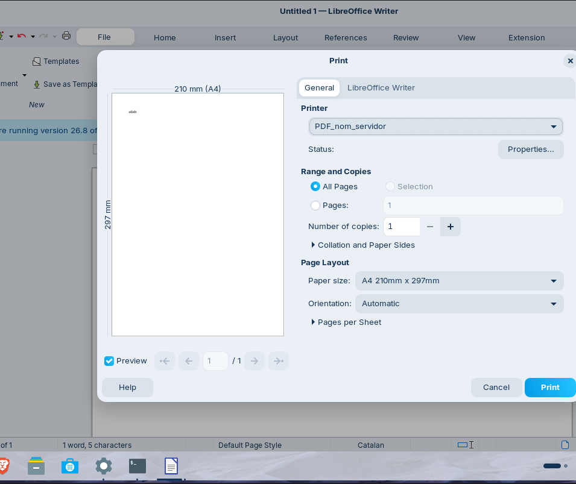

Escric un text curt i l'imprimeixo. Escullo `PDF_nom_servidor` com a impressora.

---

## 7. Comprovació dels documents generats

### 7.1 Treballs completats

Al servidor:

```bash
lpstat -W completed -o
```

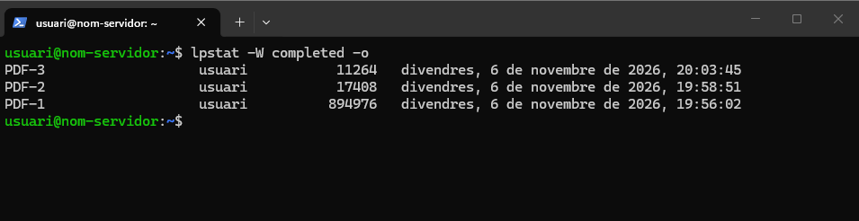

Surten els treballs **PDF-1**, **PDF-2** i **PDF-3**, tots de l'usuari `usuari`. El servidor ha rebut i acabat les 3 proves.

### 7.2 Fitxers PDF generats

```bash
ls -l /home/usuari/PDF
file /home/usuari/PDF/*
```

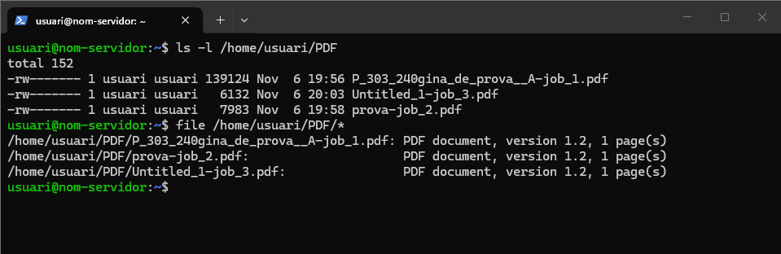

Els fitxers es desen a **`/home/usuari/PDF`**. `file` confirma que els 3 són **PDF document**.

### 7.3 Resum de les proves

| Prova | Mètode | Treball | Fitxer PDF generat |
|---|---|---|---|
| Pàgina de prova | Paràmetres → Impressores | PDF-1 | `P_303_240gina_de_prova__A-job_1.pdf` |
| Fitxer de text | `lp -d PDF_nom_servidor prova.txt` | PDF-2 | `prova-job_2.pdf` |
| Document Writer | LibreOffice → Imprimeix | PDF-3 | `Untitled_1-job_3.pdf` |

El nom del primer fitxer és estrany. És perquè cups-pdf canvia els accents de "Pàgina de prova" per codis. La "à" es converteix en `_303_240`.

---

## 8. Incidències

| Problema | Causa | Solució |
|---|---|---|
| La web de CUPS no carregava | Vaig escriure la IP malament: `193` en lloc de `192` | Escriure bé `192.168.56.101:631` |
| "No autoritzat" a l'Administració | No havia posat usuari i contrasenya | Entrar amb `usuari` i la seva contrasenya (és al grup `lpadmin`) |
| "No s'ha pogut afegir una impressora nova" a Zorin | La impressora ja s'havia detectat sola | Fer servir la que ja hi era: `PDF_nom_servidor` |
